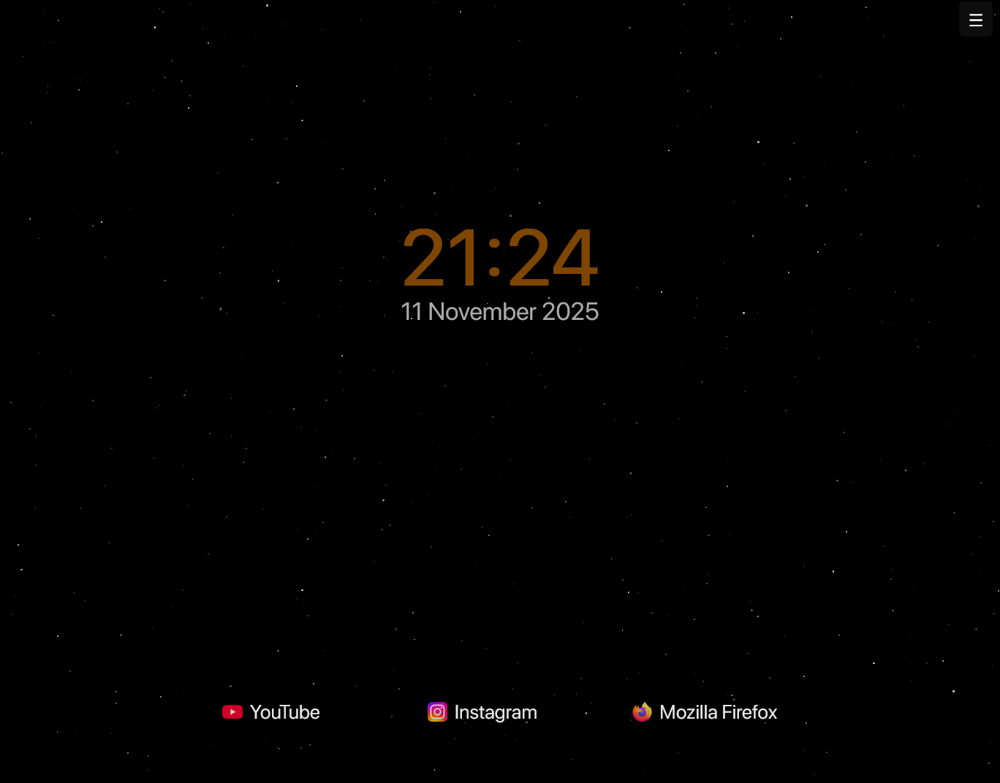
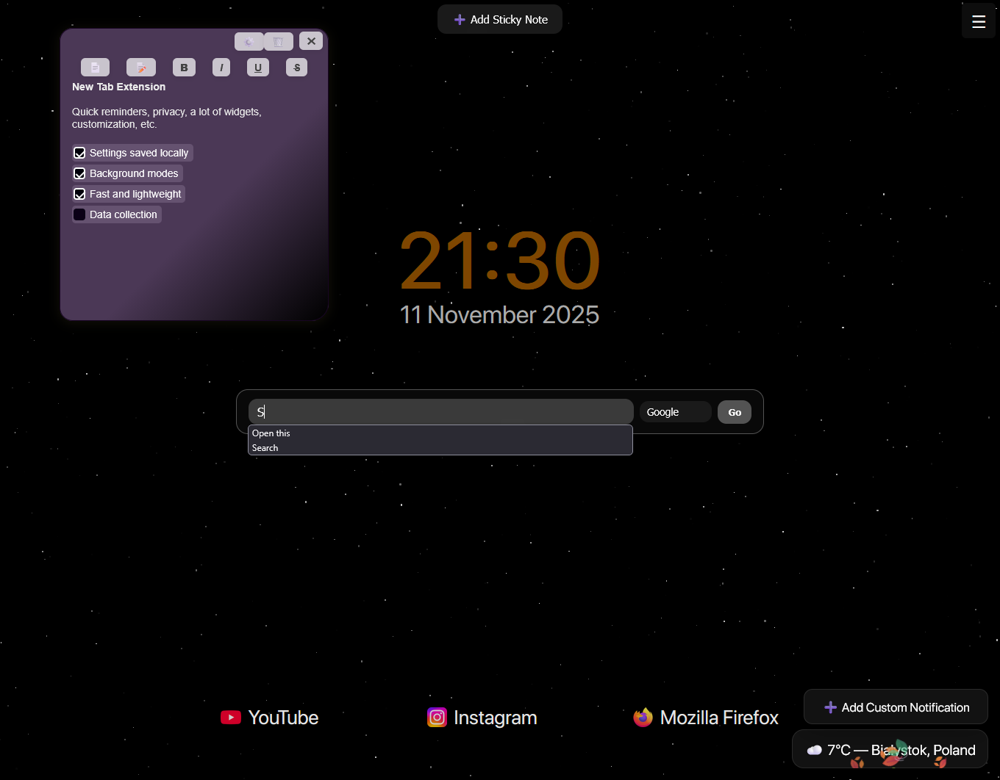
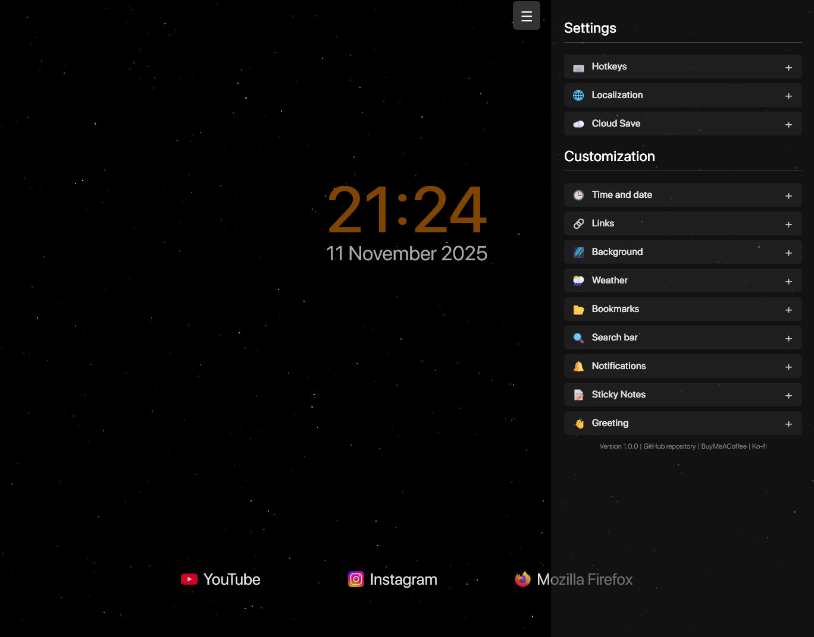
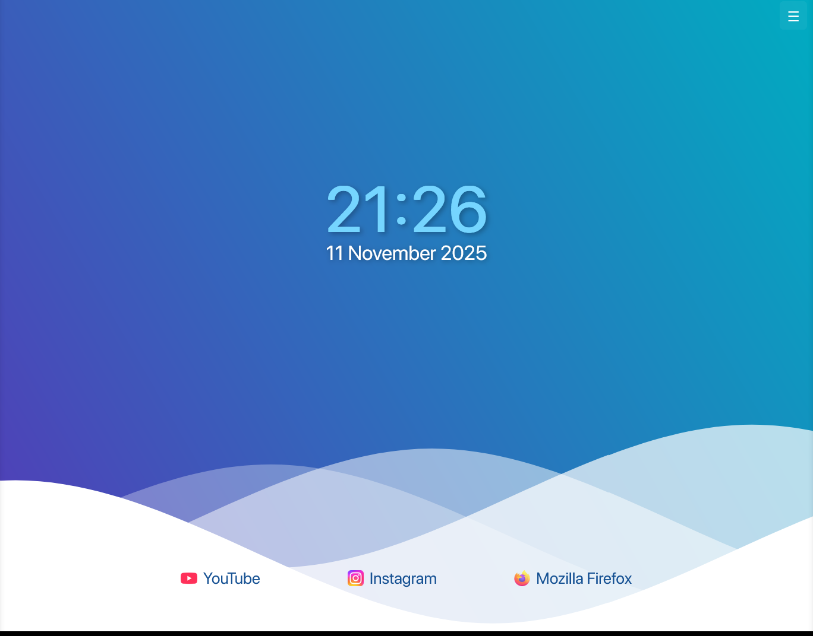
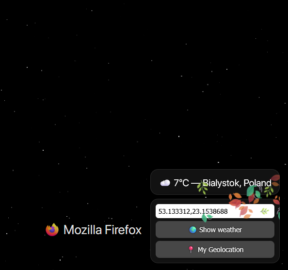

# 🌌 New Tab Extension ([Addons.Mozilla.org](https://addons.mozilla.org/en-US/firefox/addon/newtabaddon/))

**New Tab Extension** replaces Firefox's new tab page (and home page) with a customizable one:

- Animated backgrounds, your own picture, or a fresh online photo
- Up to three clocks with fonts, colors, shadows, formats and time zones
- A grid of your favorite links, a bookmarks sidebar and a weather widget
- Interface in English, Русский, Polski, Deutsch, Español, Беларуская, Українська

## Screenshots

### Main page

### Bookmarks and widgets

### Sidebar

## 🛠 Features

- 🎨 11 procedural backgrounds (starfield, waves, solar system, …) with their own color/size controls
- 🖼 Custom background image with blur, brightness, vignette and fit options
- 📷 Online photo background: random photos from [Picsum](https://picsum.photos) or keyword search on [Openverse](https://openverse.org), no API key
- 🕒 Up to 3 clocks; 24h / 12h / Arabic / Chinese / Japanese / locale formats; any time zone (daylight saving aware)
- 🔗 Links grid (1–9 keys open the first nine links), drag & drop ordering
- 📚 Bookmarks sidebar with search, pinning, renaming and deleting
- 🌦️ Weather widget powered by [Open-Meteo](https://open-meteo.com) — no API key needed
- 💾 Export / import all settings as a JSON file
- ⌨️ Hotkeys: ← bookmarks, → settings, right-click any setting to reset it

## 🔒 Privacy

Settings are stored locally in Firefox (`browser.storage.local`). There are no analytics and no accounts.
The page only talks to the network for features you turn on:

| Feature | Service | What is sent |
|---|---|---|
| Weather | Open-Meteo | the city you typed or your coordinates |
| Online photo | Picsum / Openverse | your search keyword |
| Link icons | each linked site (`/favicon.ico`) | nothing beyond loading the icon |
| Link icons via Google (optional, off by default) | Google | the addresses of your links |

All fonts are bundled with the extension.

## How to Load the Extension Temporarily (via `about:debugging`)

1. Open Firefox
2. Go to: `about:debugging#/runtime/this-firefox`
3. Click **"Load Temporary Add-on"**
4. Select the `manifest.json` file from your extension folder

> ⚠️ Temporary extensions are removed when Firefox restarts.

## 💡 Developer Notes

- Vanilla JavaScript (ES modules), HTML and CSS — no build step, no dependencies
- Start reading at `scripts/app.js`; see `CLAUDE.md` for the project structure and conventions
- Tests for settings migration and time formatting: `node --test "tests/*.test.mjs"`
- Release archive: `python release.py`
