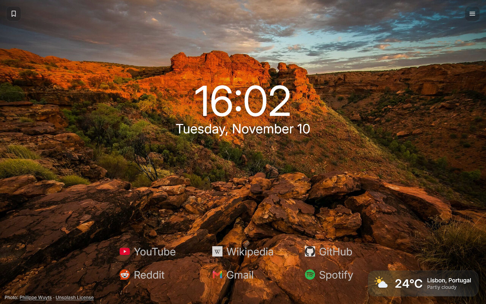
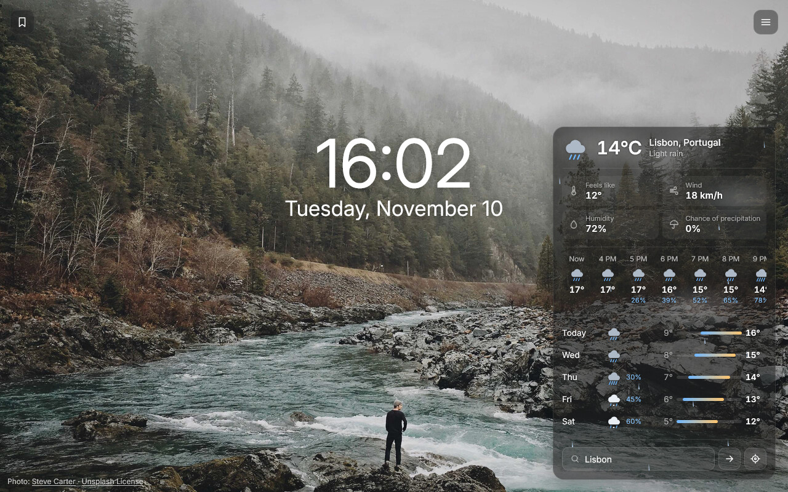
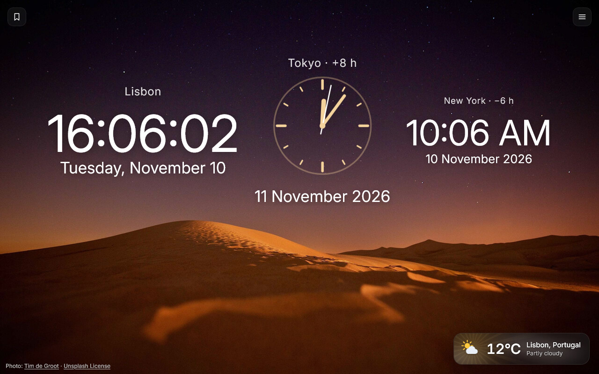
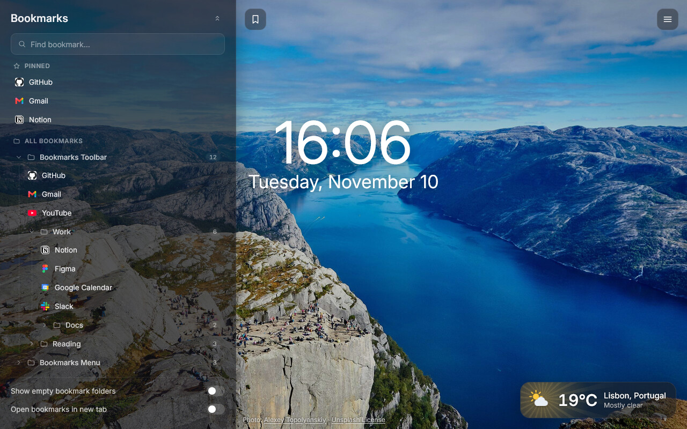
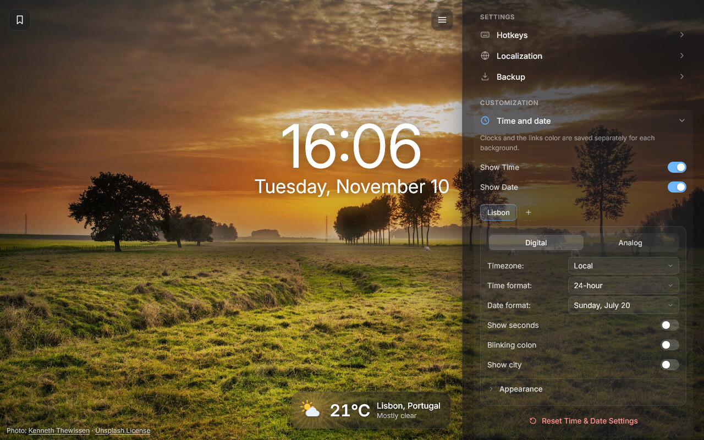
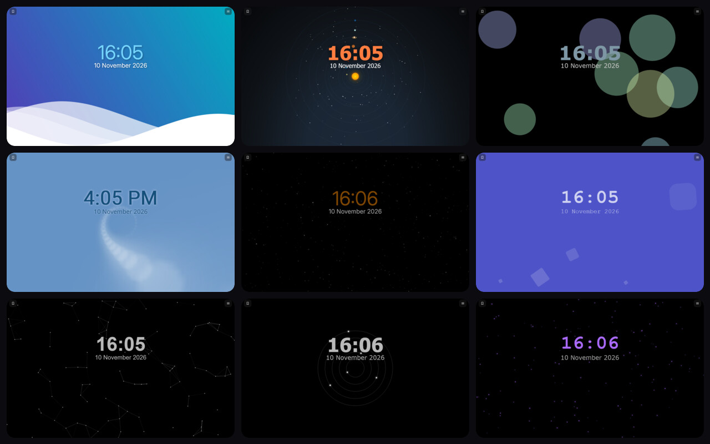

<p align="center">
  
</p>

<h1 align="center">New Tab Extension</h1>

<p align="center">
  A calm, good-looking new tab for Firefox: a clock, your links and the weather on top of a background you like.
  <br>
  <a href="https://addons.mozilla.org/en-US/firefox/addon/newtabaddon/"><b>Get it on addons.mozilla.org</b></a>
</p>



## What you get

**Backgrounds.** Eleven animated scenes (waves, a solar system, drifting particles and more), your own picture,
a random photo from Unsplash, photos for a keyword, or the Wikimedia Commons picture of the day.
You can also have a different background at night that switches by itself.

**Clocks.** Up to three, each in its own time zone and labelled with the city, so "Tokyo · +8 h" is one glance away.
Digital or analog, with seconds if you want them, and any font, color, size and shadow.

**Weather.** Current conditions, the next 24 hours and five days ahead, in °C or °F.
The card stays small until you hover it. No account or API key needed.

**Links and bookmarks.** A grid of your favorite sites (keys 1–9 open them), and a bookmarks panel with
site icons, pinned bookmarks and a search that shows where each bookmark lives.

**Settings that stay out of the way.** Everything is in one side panel. Right-click any control to reset it,
and export everything to a file to move it to another computer. Available in English, Русский, Polski, Deutsch,
Español, Беларуская and Українська.

## Screenshots

| | |
|---|---|
|  |  |
| **Weather** — hourly and five-day forecast | **World clocks** — city labels, analog style |
|  |  |
| **Bookmarks** — pinned, folders, search | **Settings** — one clock at a time |



## Privacy

Settings stay in your Firefox profile. There are no accounts, no analytics and no servers of our own.
The page goes online only for the features you turn on:

| Feature | Service | What it receives |
|---|---|---|
| Weather | [Open-Meteo](https://open-meteo.com) | the city you typed, or your coordinates |
| Name of your location | [OpenStreetMap Nominatim](https://nominatim.org) | your coordinates, once, after you press "My location" |
| Online photo | [Picsum](https://picsum.photos) / [Openverse](https://openverse.org) | your search keyword, if any |
| Photo of the day | [Wikimedia](https://commons.wikimedia.org/wiki/Commons:Picture_of_the_day) | today's date |
| Site icons | each site's own `/favicon.ico` | a normal icon request |
| Site icons through Google (off by default) | Google | the addresses of your links and bookmarks |

Fonts are bundled with the extension, so no font services are contacted.

## Development

Plain JavaScript modules, HTML and CSS. No build step and no dependencies.

1. Open `about:debugging#/runtime/this-firefox` and click **Load Temporary Add-on**.
2. Pick `manifest.json` from this folder and open a new tab.
3. After changing files, press **Reload** on the add-on card.

```
node --test "tests/*.test.mjs"     # settings migration, formatting, weather, schedule
npx web-ext lint --source-dir . --ignore-files "tests/**" "Screenshots/**" review.md "*.zip"
python release.py                  # builds "New Tab Extension.zip" for AMO
```

The code starts at `scripts/app.js`. `CLAUDE.md` describes the structure, the settings format and the rules
that keep existing users' settings working after an update.

## License

[MIT](LICENSE)
